# 开源新人培养计划 v1

> 写给即将加入的你：不需要任何基础，一开始也不用会写代码，每周 2–4 小时就够。
> 这份计划只做一件事，带你在一个真实的开源仓库里合并属于你的第一个 PR，然后顺着这条路一直走下去。
> v1.2（2026-11-24 修订：第三章换成三个能上手玩的开源项目；理论和理念的部分压到最短，能挪进附录的都挪进去了）。这份计划本身也是开源的，见文末。

> **本文结构**，不知道从哪看起，就按这张地图走：
> - **一**　开源和许可证：你的第一个任务
> - **二**　你会练到什么
> - **三**　三个好玩的项目
> - **四**　你加入的是个什么社区
> - **五**　四个大概率会踩的坑
> - **六**　怎么走：四步
> - **七**　常见问题
> - **附录 A**　手把手：你的第一个 PR
> - **附录 B**　术语表
> - **附录 C**　Gitee 功能地图与自学资源
> - **附录 D**　社区礼仪摘要
> - **附录 E**　你会练到什么（对照表）
> - **附**　这份计划也是开源的

## 一、开源和许可证：你的第一个任务

开源就两件事：代码公开，还有一份许可证。许可证才是法律授权，它明确允许任何人使用、修改、再分发这份代码。没有许可证的仓库，法律上默认"作者保留所有权利"，别人看得见，但不敢用。ai-forum 现在就缺这份许可证，所以你的第一个任务是补上它。

三档许可证，一句话版本（详细对比是你的任务）：

| 档位 | 代表 | 一句话 |
|---|---|---|
| 最宽松 | MIT | 几乎"随便用"，保留版权声明即可，全文只有几段 |
| 宽松，带专利授权 | Apache-2.0 | 类似 MIT，额外明确专利授权，条款更长 |
| 传染型 | GPL 系列 | 衍生作品必须以同样方式开源 |

怎么做这个任务：读许可证选型指南 [choosealicense.com](https://choosealicense.com/)，对比 2–3 个候选，写成一页提案。结论不重要，给出理由的过程才是这个任务要练的。

## 二、你会练到什么

这份计划不教某个框架。它想让你练会六样本事：会用 git 跟人协作、读得懂别人的代码、会用 issue 把话说清楚、接得住 review、把技术问题写下来、还能拉下一个人。每一项怎么算练到了，附录 E 有一张对照表。

### 底线：我们共同遵守的两条

这两条不能破。社区采用 [Contributor Covenant 2.1（官方中文版）](https://www.contributor-covenant.org/zh-cn/version/2/1/code_of_conduct/)作为行为准则，核心就两条：提出和大方接受建设性意见，尊重不同的主张、观点和感受。出了问题，先私下找该仓库的 Owner 沟通。

## 三、三个好玩的项目

讲道理讲十遍也没用，先看看开源的东西长什么样。下面三个项目都在 GitHub 上开源，浏览器打开就能用，不用装任何东西。玩过再往下看。

### Excalidraw：一块能随手画的手绘白板

**看**：画流程图、画草图、画脑图，白板工具能干的事它都能干。手绘风格的线条是它的招牌，看着随意，画出来还挺正式。

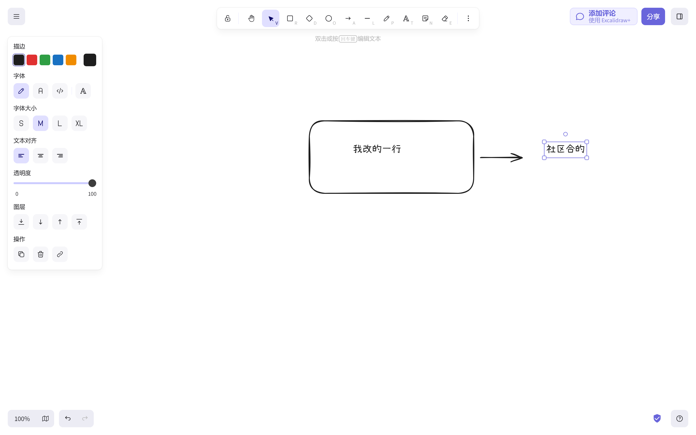

**玩**：打开 [excalidraw.com](https://excalidraw.com/)，鼠标拖一下就出来一个框，双击就能写字。画完点"分享"能存成链接，发到群里给别人看。

**做**：想自己搭一套，仓库里有 Docker 部署的说明，一条命令的事。想改点什么，中文界面文案都放在一个 json 文件里，改错别字、改翻译都算改动。仓库：[github.com/excalidraw/excalidraw](https://github.com/excalidraw/excalidraw)（MIT 许可）。

### Hoppscotch：浏览器里的 API 调试台

**看**：发一个请求，看它返回什么。Postman 的那些功能，这个开源版在浏览器里就能用，不用装客户端。

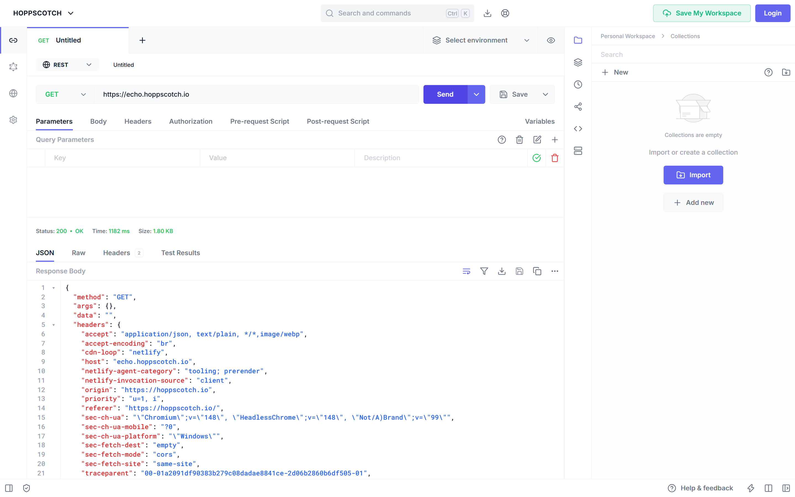

**玩**：打开 [hoppscotch.io](https://hoppscotch.io/)，选个 GET 接口点 Send，右边就出状态码和返回内容。

**做**：界面文案放在一个 json 文件里，改一句中文就是一个能提的改动。仓库：[github.com/hoppscotch/hoppscotch](https://github.com/hoppscotch/hoppscotch)（MIT 许可）。

### Mermaid：写几行字就出图

**看**：流程图、时序图、状态图，写几行文字它给你画出来。README、方案文档里的图，很多就是它画的。

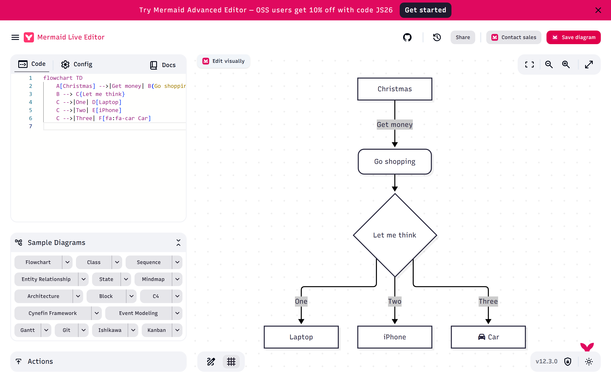

**玩**：打开 [mermaid.live](https://mermaid.live/)，左边写三行字，右边立刻出图。改一个字，图就跟着变。

**做**：想自己搭一套，npm 装上就能跑。仓库：[github.com/mermaid-js/mermaid](https://github.com/mermaid-js/mermaid)（MIT 许可，有官方中文 README）。

三个项目都有中文界面，都能自己搭一套。玩够了就往下看；想动手改点什么，从上面每个项目的"做"那段开始。

## 四、你加入的是个什么社区

- **平级小社区**：没有管理层，也没有绩效和考核。每个仓库由它的 Owner（发起并负责这个仓库的人）维护，谁的项目谁负责。
- **种子仓库**：[ai-forum](https://gitee.com/li-yongqvan/ai-forum)，面向学院师生的论坛项目，后端 Go、前端 Web，正在开发，设计文档都公开可读。
- **国内通道**：浏览、clone、开 issue、提 PR 全在 [Gitee](https://gitee.com/li-yongqvan/ai-forum)，不用额外的网络工具。

> **你会被怎样对待**。这些写进了 CONTRIBUTING：
> - 你提的 issue 和 PR，Owner **72 小时内**会有响应；
> - review 只谈代码怎么更好，不评价你这个人；
> - PR 合并即公开致谢，你的名字进贡献者名录。

你在这个社区里的位置，看这张图就明白：

[assets/community-map.html](assets/community-map.html)（浏览器直接打开，可缩放、可检索）。

## 五、四个大概率会踩的坑

1. **"等我准备好了再开始。"** good first issue 就是给你现在的水平准备的。开源里的"准备好"是在做的过程中完成的，从来不是开始的前提。第 0 步只要求你会装软件、会打字。
2. **"改这么小，好意思提 PR 吗？"** 好意思。修一个错别字也是贡献。小 PR 评审快、容易合并，社区明文鼓励小步提交。
3. **"被打回来了，是不是我搞砸了？"** 不是。几乎所有 PR 都经历过修改往返，这是流程的正常一环，说明有人在认真看你的东西。晾着没人理才需要担心。
4. **"这个问题太蠢，不敢问。"** 你不问，它会原封不动卡住下一个人。把问题和报错原文公开问出来，等于替后面的人把路修好了，这本身就是贡献。

## 六、怎么走：四步

四步的主线、每一步的完成标准、卡住了怎么绕回来，这张图上都标了：

[assets/growth-path.html](assets/growth-path.html)（浏览器直接打开，可缩放、可检索）。

没有晋升，也没有考核。每一步只有一个完成标准，到了就算过。想慢就慢，想停也没人催。

整套上手按两周设计：第 1 周装环境、跑通一遍流程，第 2 周认领任务、合并你的第一个 PR。两周之后不再按周排期，第 2 步和第 3 步按自己的节奏来。

### 第 0 步 · 准备（第 1 周，约 2–3 小时）

装好工具，把流程空跑一遍：

1. 注册 Gitee 账号，安装 git，配置用户名和邮箱
2. 学四组命令：`clone`、`branch` / `switch`、`add` 和 `commit`、`push`。附录 A 会带你逐个用一遍
3. 空跑一遍完整流程：照着附录 A 操作，fork 本计划所在的仓库，改一个错别字，提出你的第一个 PR。别怕改错，这就是练习场

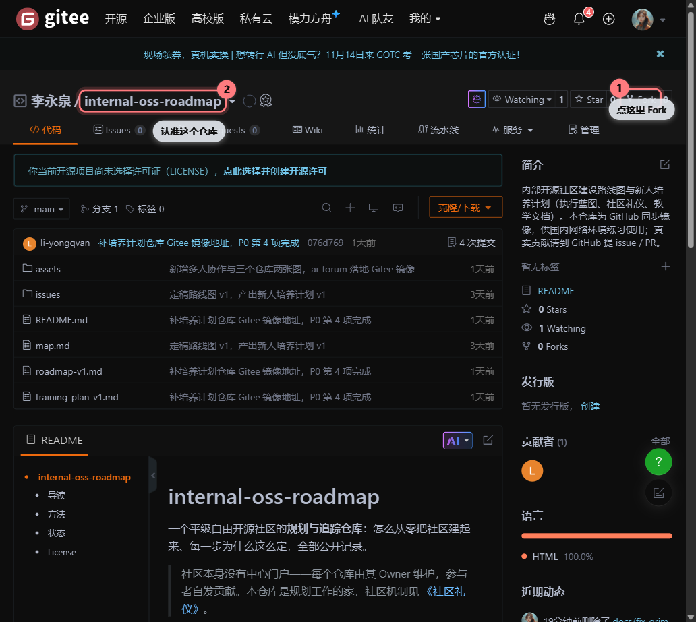
*动手的起点长这样：① 右上角点 Fork，把仓库复制一份到自己名下；② 认准这个仓库（internal-oss-roadmap）。*

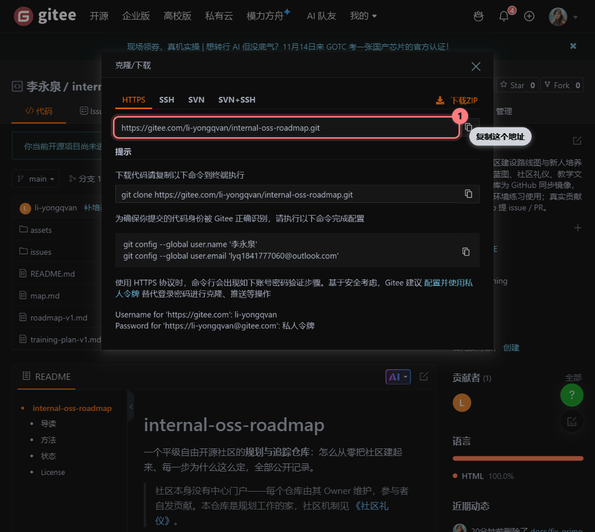
*地址在这里复制：① 展开克隆/下载，把这个 HTTPS 地址贴进附录 A 的 git clone 命令里。*

**完成标准**：不看笔记能说出"分支是什么、PR 是什么"。
**卡点自救**：git 报错看不懂，把报错原文贴进 issue 问。贴原文提问，本身就是第 5 项能力的开始。
**选看（不用看完再动手）**：想先看别人演示一遍，官方 [Gitee 新手入门](https://gitee.com/help)十来分钟在浏览器里走完整个 PR 流程，或康文昌的 18 分钟视频。都在附录 C 一档资源里。

### 第 1 步 · 首个贡献（第 2 周，约 3–4 小时）

从标注了 `good first issue` 的入门任务里认领一个，认领方式是在 issue 下评论"我来做"。本社区目前有三个入门任务，难度从低到高，就是下面这三条。仓库里要是暂时还没有带这个标签的 issue，就按清单里的任意一条自己提一个 PR，描述里写明"我来做第几条"，Owner 确认后就算认领。

- [ ] **给 ai-forum 选一个开源许可证（LICENSE）**：读许可证选型指南，对比 2–3 个候选，写成一页小提案

- [ ] **写 README 新人快速上手**：你现在就是新人，你最知道新人会在哪卡住，这个视角以后就没了

- [ ] **补全部署文档**：照着部署一遍，把缺的步骤、报过的错原原本本写下来

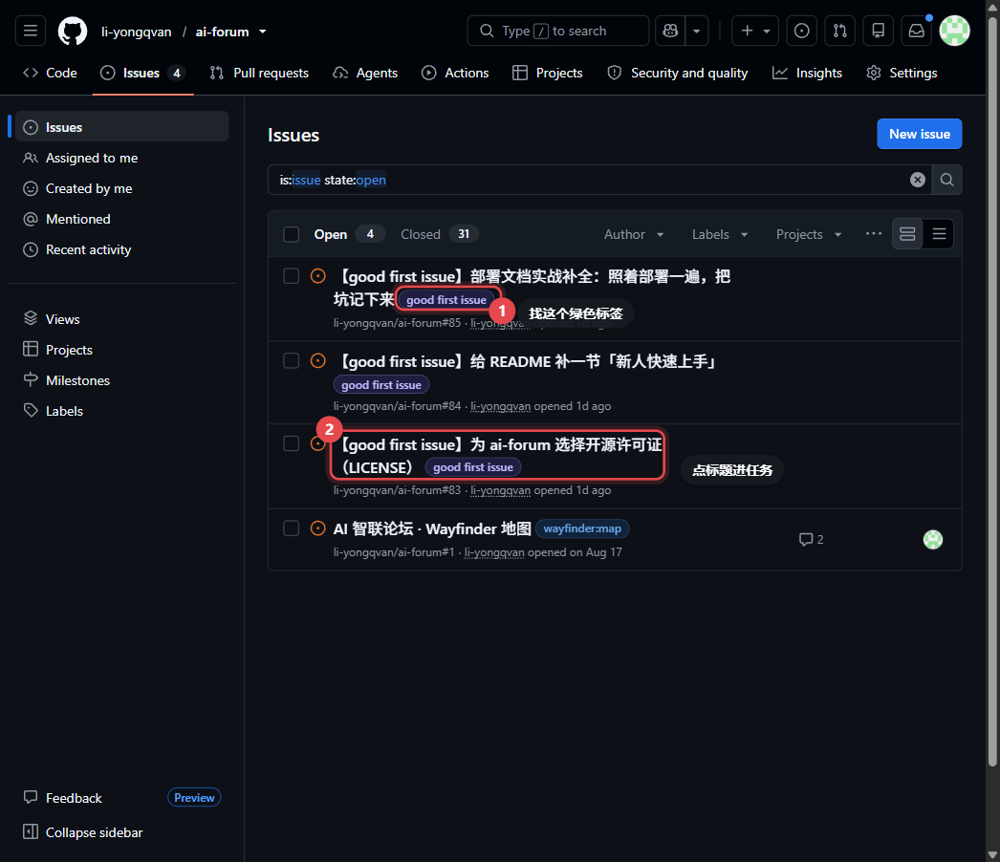
*第一个真实任务在 ai-forum 的 issue 列表：① 找绿色 good first issue 标签；② 点标题进任务，在评论区写"我来做"认领。*

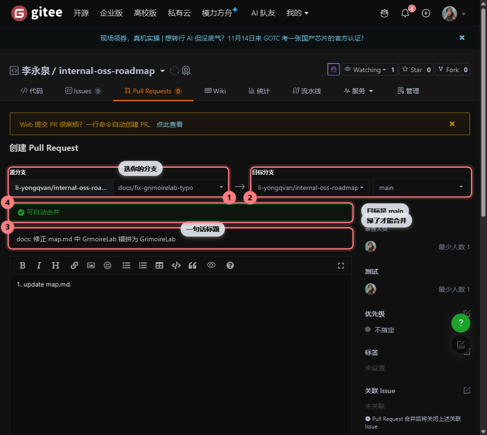
*任务做完后提 PR 的画面：① 源分支选你的分支；② 目标是 main；③ 标题一句话说清改了什么；④ 看到"可自动合并"绿标，就绪。*

**完成标准**：一个被合并的 PR，加上你的名字出现在贡献者名录。

**为什么是这三个**：都从真实需要里来。第 1 个任务练的是做决定并给出理由，这是开源里最值钱的动作之一。

### 第 2 步 · 独立贡献（两周上手期之后，按需认领）

认领常规 issue（非 good first issue），独立走完讨论、修改、合并。这一步你会第一次遇到几件事：PR 被打回、意见你不认同、讨论之后各让一步。仓库里要是暂时没有可认领的常规 issue，就从上面的入门任务里挑一条继续做，或者把你在使用中发现的改进提成一个 issue。写 issue 本身就是第 3 项能力。

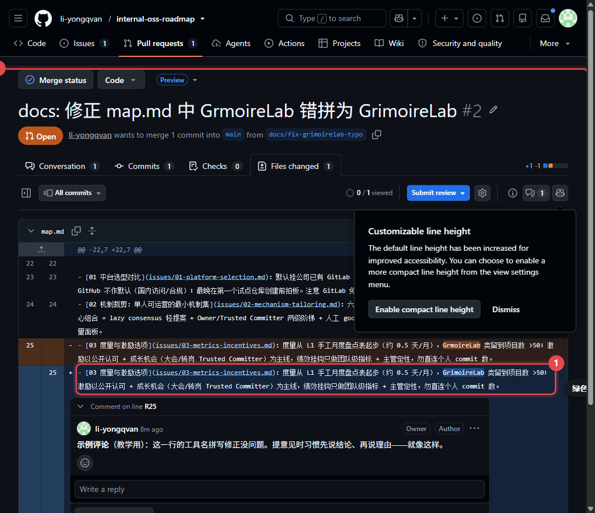
*PR 的 Files changed 页：① 绿色 = 新增的行，reviewer 会逐行看；② 意见就写在这样的线程里——本图来自社区的真实演示 PR（internal-oss-roadmap #2）。*

**完成标准**：不靠任何人手把手，完成一个常规任务。

**这一步的真相**：不舒服是正常的。被 review 挑毛病是开源的日常，前三次最难，之后你会开始主动要反馈。

### 第 3 步 · 回馈（不设时限，但有三个可查的目标）

这一步没有截止时间，但要有能验证的目标。下面三条各挑一条，三个月内做到就算过：

- **review 别人的 PR**：三个月内至少提 3 次，哪怕只是指出一个错别字，评上"有帮助"也算数
- **带一个新人**：至少陪一个人走完第 0 步，帮他把环境装好、fork 到自己账号、提上第一个 PR
- **开自己的仓库，成为 Owner**：把自己的第一个项目公开出来，并让至少一个别人参与进来，提 issue 或 PR 都算

三个月后回来看：做到哪条，就把哪条写进你的贡献记录。没做到也不丢人，社区里很多人还停在第 1 步。

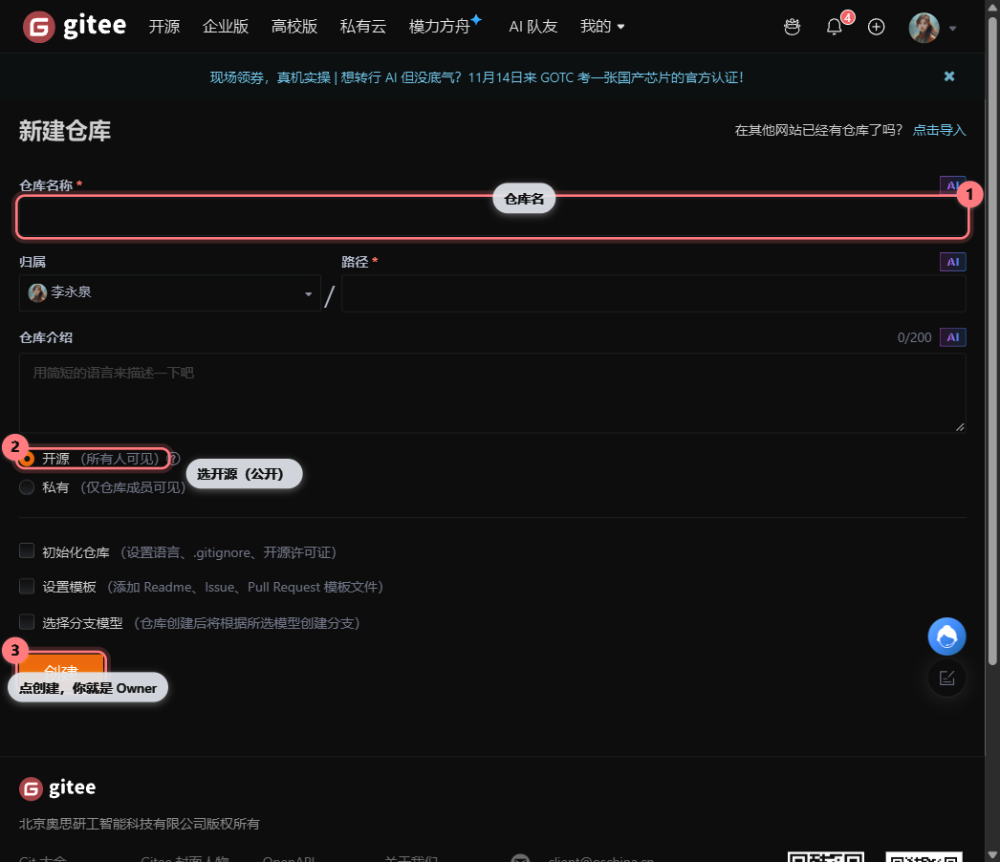
*第 3 步的终点之一——开自己的仓库（图为 Gitee）：① 起个仓库名；② 选开源（公开）；③ 点创建——从这一刻起，你就是 Owner。*

## 七、常见问题

### Q：需要会写代码吗？

前两步不需要。首批三个入门任务分别是"做决策写提案"和两个文档任务。第 2 步起的常规任务会碰到代码，从真实任务里学是最快的学法。

### Q：没学过 Go 怎么办？

ai-forum 后端是 Go，前端是 Web，但入门任务不要求写 Go。真要上手时你已经在社区里了，问路比一个人啃快得多。

### Q：每周 2–4 小时，真的够吗？

前两步够。第 2 步的常规任务视难度可能超出一点，超了就说一声，任务可以再拆小，拆任务也是 Owner 的活。

### Q：中间忙考试 / 实习去了，怎么办？

说一声就行。没有违约金也没有违约感：issue 让给别人接手，你回来随时继续，贡献记录一直在。

### Q：这些经历以后有什么用？

每一个合并的 PR 都是公开、可验证的协作记录。简历上写"熟悉 Git 协作、有开源贡献"的时候，你能拿出链接。

### Q：clone / push 偶尔超时怎么办？

社区全部放在 Gitee，浏览和 clone 零网络门槛，不用额外的网络工具。真的遇到加载慢或 push 超时属正常，换个时段多试几次即可；仍然不行就把报错原文贴进 issue 公开问。

### Q：仓库里还没有可认领的 issue，我从哪开始？

先做第 1 步的三个入门任务之一。仓库里还没有就按清单自己提一个 PR，描述里写明"我来做第几条"；同时把你在使用中发现的改进写成 issue。社区不靠存量任务运转，issue 从 0 到 1 正是你现在能做的事。

### 节奏与投入

- **每周 2–4 小时**。固定一个时段，比如周六上午，比"有空就做"靠谱得多
- **卡住超过 1 小时就求助**。独自死磕不是美德，是浪费你的时间
- 中途要退出随时可以，说一声即可，没有违约感

一个可以照抄的一周示例：

| 时段 | 做什么 | 时长 |
|---|---|---|
| 周六上午（固定主时段） | 推进认领的任务：读代码、改文件、提 PR | 2 小时 |
| 周中碎片（任选其一） | 看 issue 讨论、回应 review 意见 | 30 分钟 |
| 任何时候卡壳 | 自救阶梯：先搜，再公开问 | 超 1 小时就求助，别恋战 |

### 多人怎么在同一个项目里不打架

主线、你和同伴的并行分支、一个真实的冲突点和它的标准解法，这张图上都画了：

[assets/collab-branches.html](assets/collab-branches.html)（浏览器直接打开，可缩放、可检索）。

六条规则（图里都有对应位置）：

1. 动手前先认领：issue 下评论"我来做"，重复劳动从源头消失
2. 分支天然隔离：各改各的分支，main 永远可用
3. 冲突不是事故：git 标出冲突行，git pull 后按提示处理，搞不定贴 issue 求助
4. 小步 PR 是润滑剂：越小 review 越快、冲突越少
5. review 是协作不是考试：永远对代码，不对人
6. 一切公开、一切异步：讨论留在 issue 和 PR 里，72 小时内有响应，谈不拢 Owner 定夺

> 第 0–1 步只需记住第 1、2、6 条；其余第 2 步全部用到。

### 卡住怎么办（自救阶梯）

1. **先搜**：README、已有 issue，拿报错原文搜一下，一半的问题别人踩过
2. **再问**：在对应 issue 里公开问，写清"我做了什么、期望什么、实际看到什么、报错原文"
3. **一周没响应**：在原讨论串心平气和跟帖，@ 一下 Owner，催是可以的，礼貌地催

三个高频场景：

- **git 搞乱了**：几乎总能救回来，速查命令见附录 A 末尾。贴出命令历史和报错求助，别删库重试
- **PR 被要求修改**：这是流程的正常部分，不是你搞砸了。逐条回应，不同意的可以讨论，怎么讨论见《社区礼仪》Q3
- **看不懂代码**：先找设计文档和 README。还是看不懂，说明文档缺了这一块，把它变成一个 issue，这本身就是贡献

---

## 附录 A · 手把手：你的第一个 PR

流程全景图：网页端和本地各干什么、被打回后怎么循环回去，一张图看全。下面是逐步操作：

[assets/first-pr.html](assets/first-pr.html)（浏览器直接打开，可缩放、可检索）。

> 零基础照做即可，以本计划所在的仓库为练习场。命令右边的 `#` 是说明，不用输入。
> **本计划的仓库在 Gitee**：[gitee.com/li-yongqvan/internal-oss-roadmap](https://gitee.com/li-yongqvan/internal-oss-roadmap)。下面的步骤**一条都不用改**——直接在这个仓库上做：clone 用上面这个地址，网页上的 Fork、PR 都是标准布局，界面全中文。在这里练出的手感迁移到任何平台都零成本。

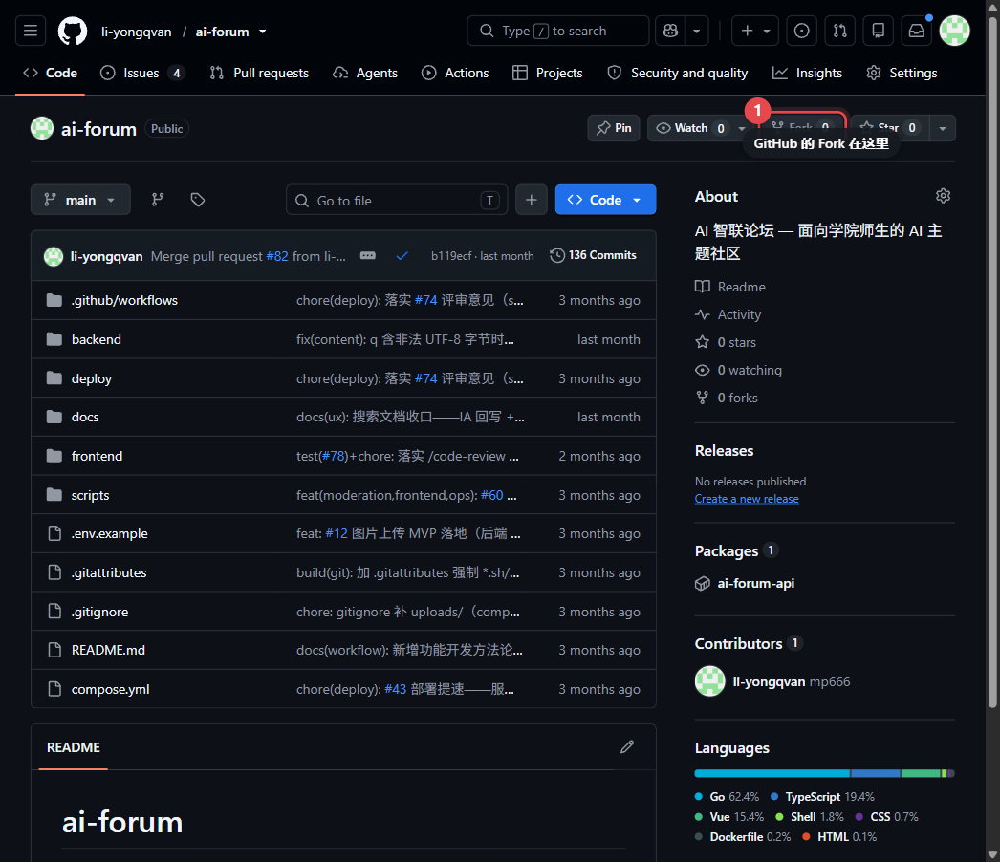
*仓库页右上角就是 Fork 按钮——你在 Gitee 用过的完全同构，迁移零成本。*

### 准备（只做一次）

- [ ] 注册 Gitee 账号

- [ ] 安装 git：到官网 git-scm.com 下载，一路默认下一步即可

- [ ] 告诉 git 你是谁（名字随意，邮箱用注册 Gitee 的那个）：

```bash
git config --global user.name "你的名字"git config --global user.email "你的Gitee邮箱"
```

### 第一步：Fork 并克隆

在浏览器打开本仓库页面，点右上角 Fork，把仓库复制一份到你自己的账号下。然后克隆你那份到本地（把「你的用户名」换成你自己的）：

```bash
git clone https://gitee.com/你的用户名/internal-oss-roadmap.gitcd internal-oss-roadmap
```

### 第二步：建分支、做修改

```bash
git switch -c my-first-pr      # 新建分支 my-first-pr 并切换过去
```

用任意编辑器打开仓库里的文件：修一个错别字，或在某份文档里补一句你觉得该说的话，保存。

### 第三步：提交并推送

```bash
git add 改动的文件名            # 标记"待提交"；全部改动就写 git add .git commit -m "docs: 修正了××处的错别字"   # 引号里说清你做了什么git push -u origin my-first-pr  # 推到你自己的仓库
```

网页路径（还没装 git？先走这条，同样成立）：仓库里打开任一文件，点编辑（铅笔图标），改内容，页面底部填提交信息、填一个新分支名，提交。第 0 步的练习走这条路完全合规，改的文件、提的分支和终端路径一模一样，之后再切到终端毫无违和。

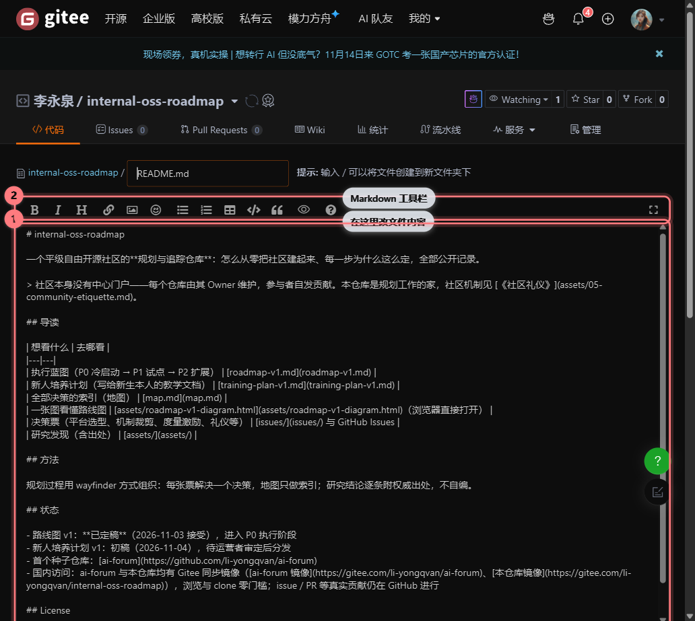
*① 在这里改文件内容；② 上方是 Markdown 工具栏。*

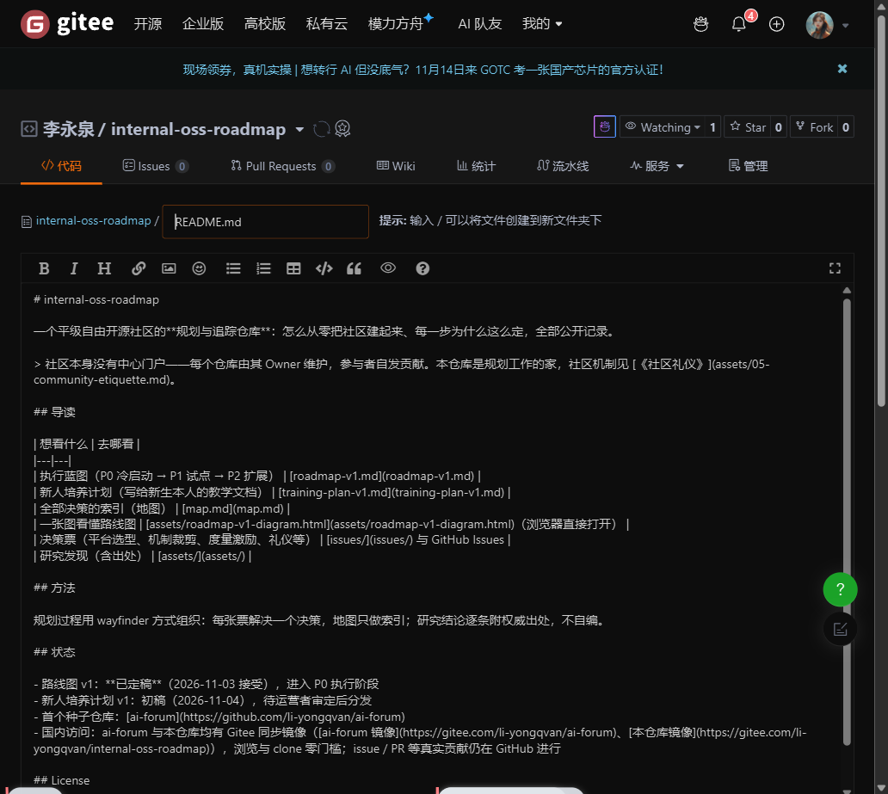
*① 一句话说清改了什么；② 填一个新分支名，别动 main；③ 点提交。*

### 第四步：发起 PR

推送后刷新你的仓库页面，Gitee 顶部有 Pull Requests 标签，点进去就是「创建 Pull Request」页面。标题一句话概括改动，正文补充背景和原因，若有对应 issue 就写上 Closes #编号 。填完点提交。

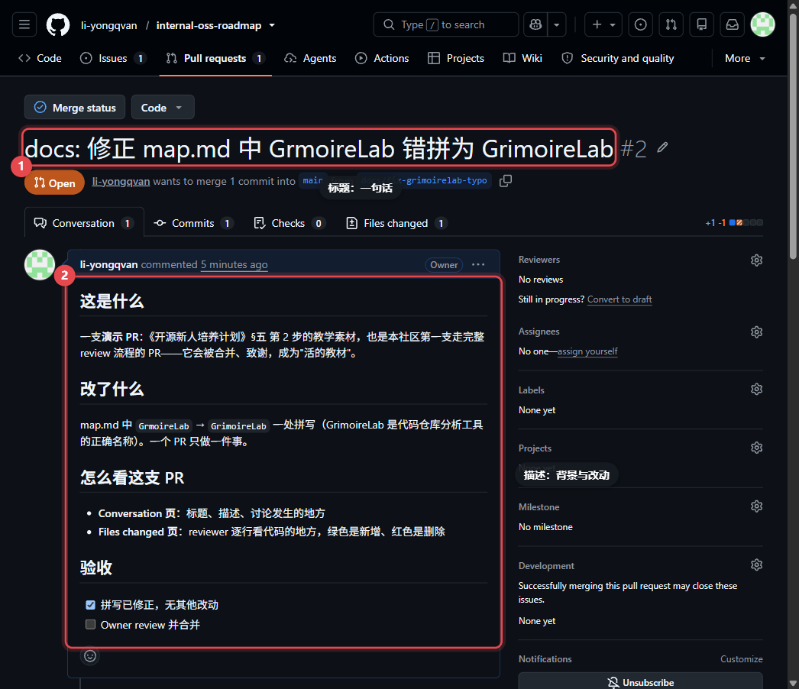
*PR 的 Conversation 页：① 标题一句话说清改了什么；② 描述区写背景与改动——本图来自社区的真实演示 PR（internal-oss-roadmap #2）。*

### 第五步：响应 review

- Owner 会在 72 小时内回应
- 被要求修改很正常：改完在同一个分支再 git add、git commit、git push，PR 会自动更新，不要关掉重开
- 合并后，回到正文第 1 步，去认领一个真正的任务

### 出错了怎么办

- git status：随时敲它看当前状态，是信息量最大的一条命令
- 想丢弃还没 commit 的改动从头再来：git restore . ，已经 commit 的不受影响
- 命令报错看不懂：把报错原文完整贴进 issue 公开问，这是能力，不丢人

---

## 附录 B · 术语表（按你会遇到的顺序）

先看图再看表。原仓库、你的 fork、你的本地，三个仓库和五条箭头（fork / clone / push / PR / pull）。新手最大的疑惑"为什么有三个仓库"，这张图说清楚：

[assets/three-repos.html](assets/three-repos.html)（浏览器直接打开，可缩放、可检索）。

| 术语 | 一句话解释 |
|---|---|
| 仓库（repo） | 一个项目的全部文件和全部历史，Gitee 上的基本单位 |
| fork | 把别人的仓库复制一份到自己账号下，之后随便折腾都不影响原仓库 |
| clone | 把仓库下载到你自己的电脑上 |
| 分支（branch） | 不动主线、另开一条修改线，改坏了直接扔掉也不心疼 |
| commit | 一次本地保存，必须附一句说清"我改了什么"的说明 |
| push | 把本地的提交上传到远端仓库 |
| PR（Pull Request） | 请求原仓库接纳你分支上的改动；也是讨论和评审发生的场所 |
| review | 他人逐条查看你的改动并提意见；永远对代码、不对人 |
| issue | 任务、bug、讨论的载体，社区所有公开沟通的家 |
| 认领 | 在 issue 下评论"我来做"，让别人知道这活有人干了 |
| good first issue | 为新手准备、承诺额外辅导的入门任务标签 |
| 镜像仓库 | 与源仓库定期同步的副本；本社区已整体迁到 Gitee，不再需要镜像 |
| Owner | 负责某个仓库的人；谁的项目谁维护 |
| 贡献者名录（CONTRIBUTORS） | 记录每一位贡献者的文件，PR 合并即上榜 |
| 72 小时惰性共识 | 讨论性提案公示 72 小时无人反对即视为通过 |
| 行为准则（CoC） | 社区底线规则，本社区用 Contributor Covenant 2.1 |

---

## 附录 C · Gitee 功能地图与自学资源

> 这是地图，不是任务清单：一档功能你会在第 0–1 步自然学会，不用提前学；二档碰到时再回来查；三档只需见过名词、不必慌。

### 功能三档

| 档位 | 功能 | 你什么时候会用到 |
|---|---|---|
| **一档 · 生存必需** | 仓库、fork、分支、PR、issue、Markdown、Stars / Watch | 第 0–1 步，附录 A 全部覆盖 |
| **二档 · 协作进阶** | Discussions、Wiki、Projects、Pages、Gist、Release、Insights、个人主页 README | 第 2 步起按需认 |
| **三档 · 专业开发** | Actions、Codespaces、Packages、安全扫描（Dependabot）、组织账号、Copilot | 本社区阶段用不到，见名词不慌即可 |

> Gitee 上这些功能几乎全部同名存在（仓库 / Fork / Pull Request / Issue / Star），界面全中文，这就是"手感 100% 通用"的含义。

### 资源（官方在前，视频在后；B 站链接失效就搜标题）

#### 一档 · 第 0 步选看，看完就动手

- [Gitee 官方入门中心](https://gitee.com/help)，中文。其中 [Gitee 新手入门](https://gitee.com/help)在浏览器里亲手走完 PR 全流程，和附录 A 互补
- 『教程』一看就懂！Gitee 基础教程，偶尔有点小迷糊，5 分钟（[B 站](https://www.bilibili.com/video/BV1hS4y1S7wL/)）
- git、Gitee 保姆级教程（含提交 PR 全流程），康文昌，18 分钟（[B 站](https://www.bilibili.com/video/BV1s3411g7PS/)）
- [Gitee（码云）](https://gitee.com)，国内开源托管平台，本社区的仓库都在这里。公开仓库需通过平台审核，属正常流程

#### 二档 · 第 2 步之后，按需取用

- [Gitee 官方学习平台](https://gitee.com/educations)，官方课程、学习路径、产品指南，免费
- Gitee 新手指南：这个星球最强资源库，杰森的效率工坊，11 分钟，讲怎么把 Gitee 当资源库用（[B 站](https://www.bilibili.com/video/BV14qh8ztEhv/)）
- Git + Gitee 核心概念大串讲，技术爬爬虾，43 分钟，概念成体系（[B 站](https://www.bilibili.com/video/BV1ySLc6QEcB/)）
- 想系统补 Git 的：Git 通俗易懂（遇见狂神说，1 小时 50 分，[B 站](https://www.bilibili.com/video/BV1FE411P7B3/)）、Git 全套教程（尚硅谷，4 小时 53 分，[B 站](https://www.bilibili.com/video/BV1vy4y1s7k6/)）。**计划里没有任何一步要求先看完这些**
- 国内开源活动（如开源之夏）：大量项目托管在 Gitee，想走国内开源路线时从这里进

#### 三档 · 不配资源

用到的那天，[官方文档](https://gitee.com/help)是你唯一需要的入口。

### 延伸阅读（均为中文或官方中文版）

- 《社区礼仪》：本计划全部协作规则的完整版与出处，摘要见附录 D
- [如何为开源做贡献](https://opensource.guide/zh-hans/how-to-contribute/)（开源官方 Open Source Guides）
- [行为准则 Contributor Covenant 2.1](https://www.contributor-covenant.org/zh-cn/version/2/1/code_of_conduct/)
- 更多按功能分档的学习资源，见附录 C

## 附录 D · 社区礼仪摘要

下面五条来自社区的《社区礼仪》，是日常协作里反复用到的规矩。完整版连同每条的出处都在那份文档里，有兴趣的去看，不感兴趣的跳过。

1. **公开**：所有讨论在 issue 和 PR 里公开进行，不私下拍板。"开源项目所有的沟通都应该是公开的。"
2. **小步**：一个 PR 只做一件事，一百行上下正好，一千行太大。小 PR 合得快，你拿到反馈也快。
3. **对代码，不对人**：review 永远评论代码，不评论开发者。反过来也一样，你收到意见时，把它当成对方在帮代码库，不是来挑你毛病的。
4. **馈赠与回流**：你被 review 帮过，回头就去 review 别人。每个贡献者的名字都会记进仓库的贡献者名录。
5. **说了就算**：认领了任务做不到，要说出来让别人接手。中断不丢人，玩消失才丢人。

## 附录 E · 你会练到什么（对照表）

第二章那六样本事，每一项怎么算练到了。

| # | 能力 | 怎么证明它 |
|---|---|---|
| 1 | 用 git / Gitee 协作 | 独立走完分支、修改、提 PR、按意见改、再合并的完整流程 |
| 2 | 读懂陌生代码库 | 能说清 ai-forum 某个模块的输入、输出和它在大图里的位置 |
| 3 | 用 issue 协作 | 会报一个让别人"亲眼看到程序失败"的 bug，会认领任务 |
| 4 | 接受并回应 review | 被要求修改时不慌、不怼，逐条回应，不同意的能摆理由讨论 |
| 5 | 书面表达技术问题 | PR 描述和 issue 让没有上下文的人也能看懂 |
| 6 | 帮助下一个人 | 你踩过的坑，回头能给别人指出来 |

---

## 附：这份计划也是开源的

你对这个计划本身的任何改进，改错字、补一个你踩过的坑、调整某一步的说法，都欢迎直接提 PR。它可能就是你练手的第一个仓库。

每带完一批新人复盘一次：卡在哪一步，就改哪一步，版本号往前走。

### 交互版图（已移出正文）：5 张图的交互版 HTML 改为随仓库分发，放在仓库 assets/ 目录，需要时自取
