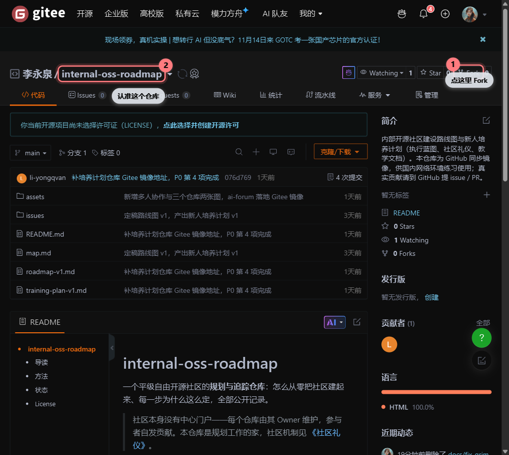
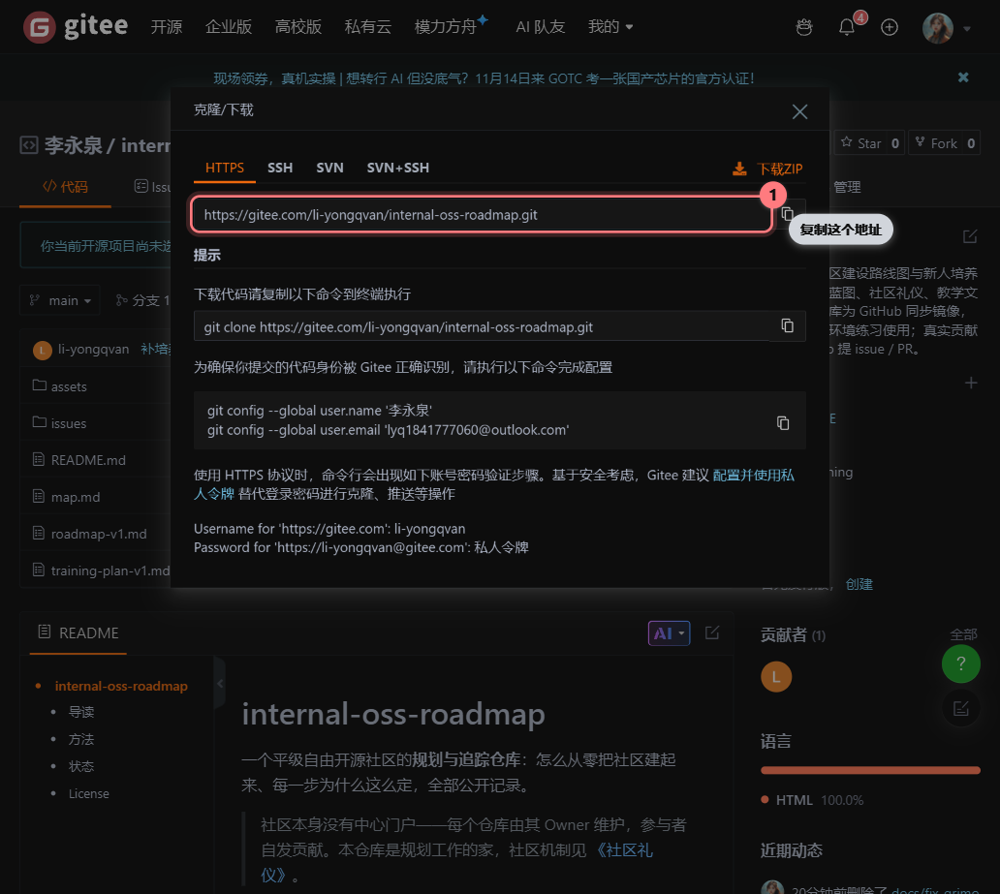
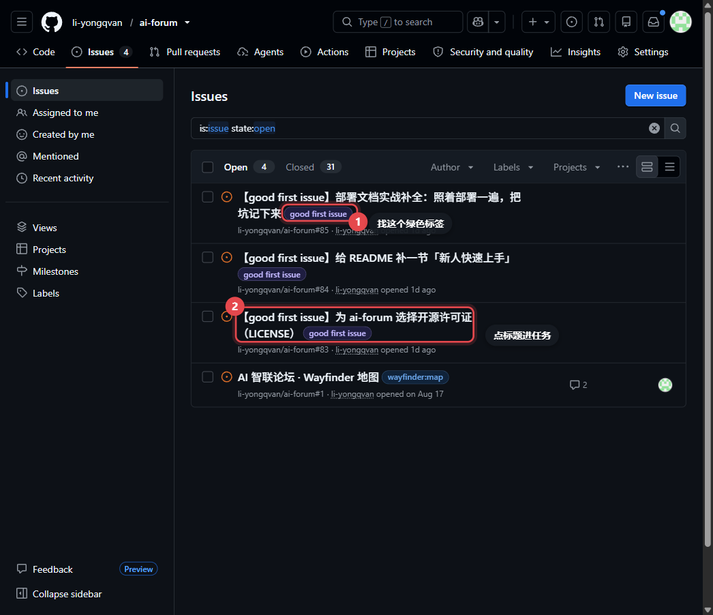
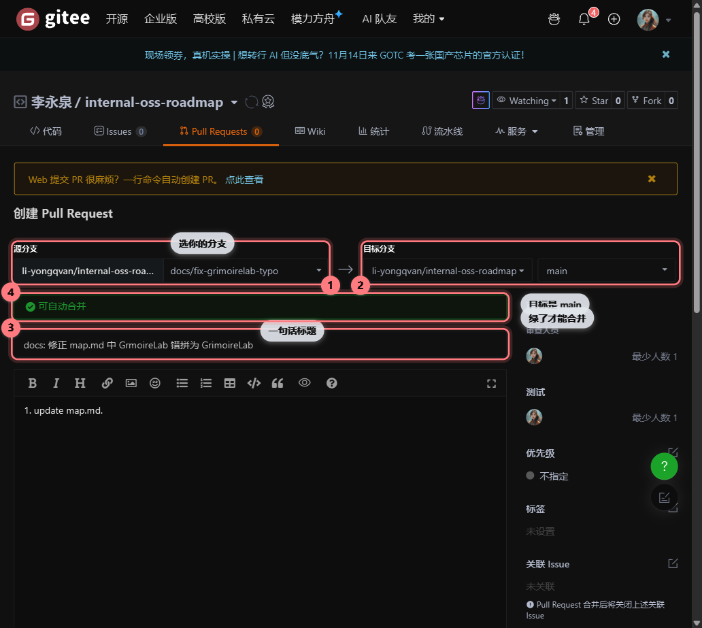
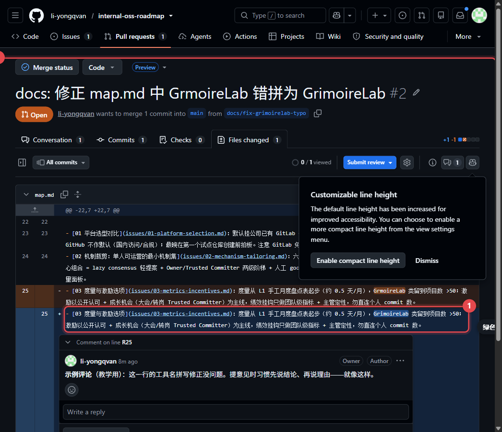
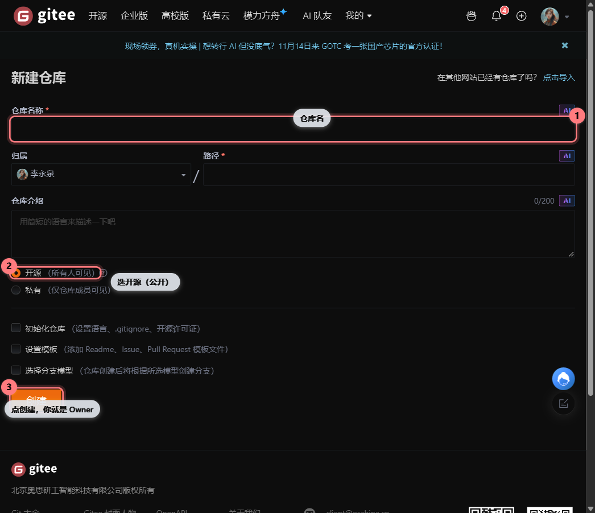
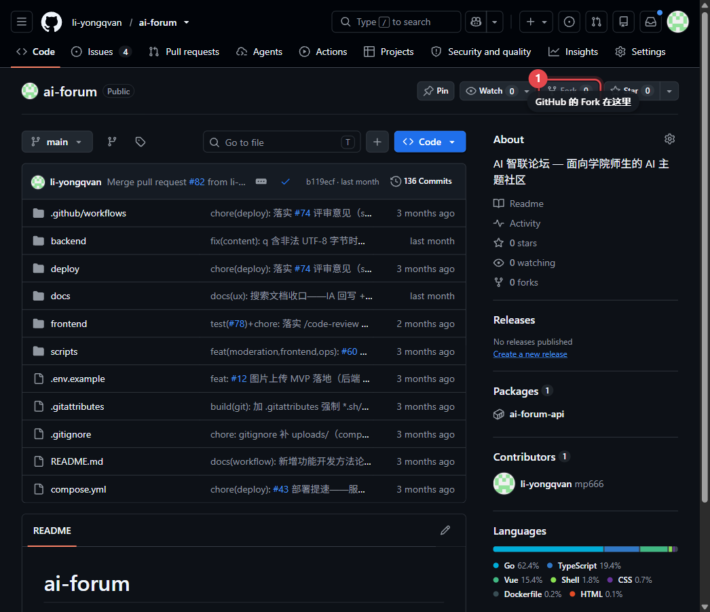
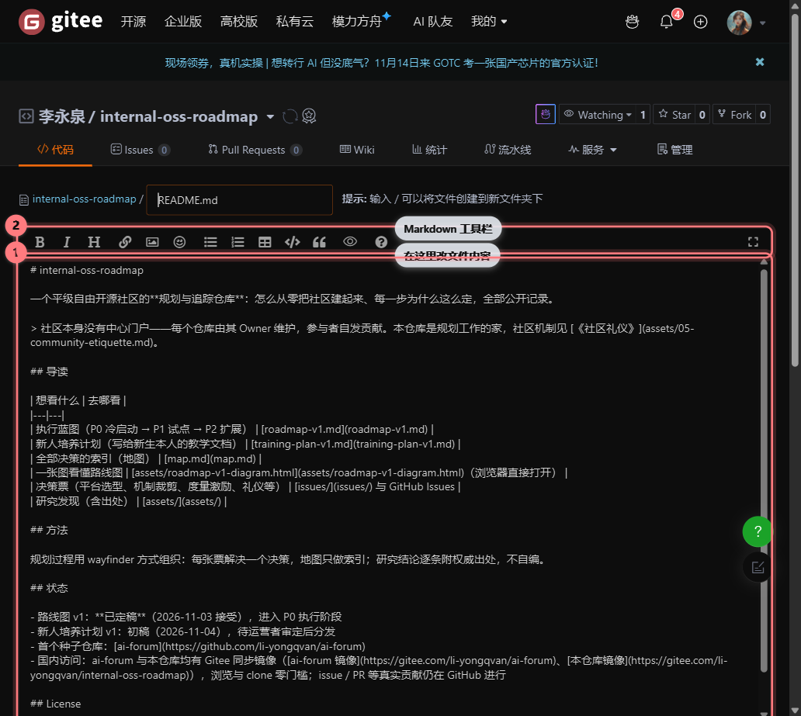
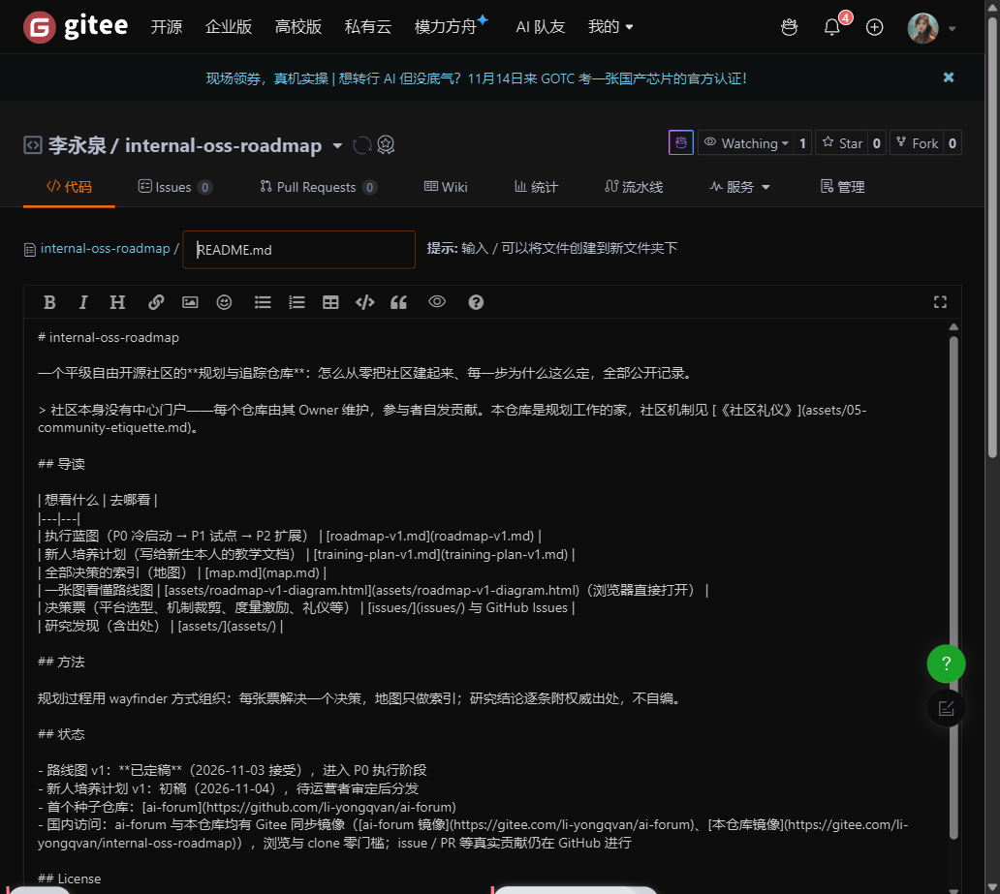
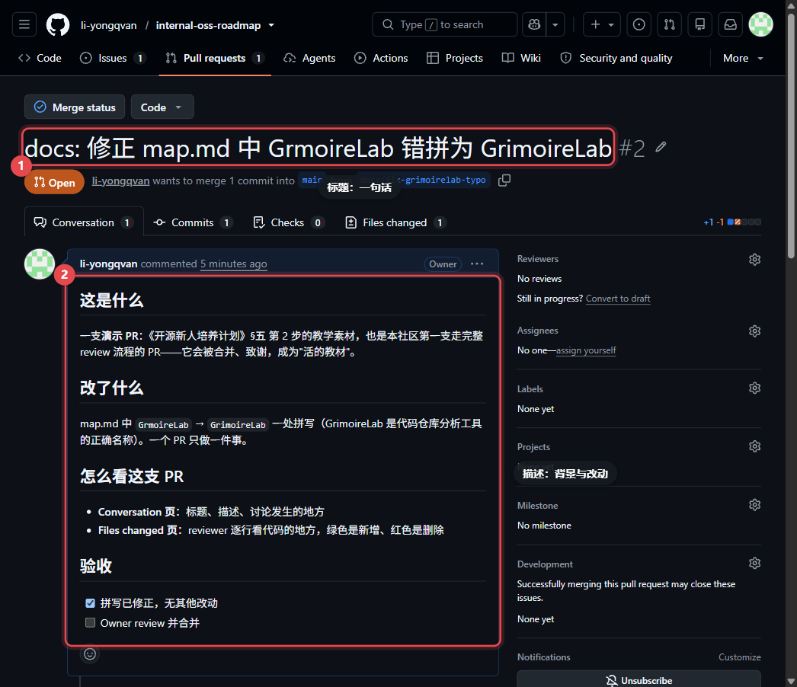

# 开源新人培养计划

> 写给即将加入的你——不需要任何基础，一开始也不需要会写代码，每周 2–4 小时就够。
> 这份计划只做一件事：带你在一个真实的开源仓库里合并属于你的第一个 PR，然后沿一条具体的路走下去。
>
> v1（2026-11-05 修订：新增多人协作一节、Gitee 双仓库方案与附录 C 功能地图）。本计划本身也是开源的，见文末。

## 一、我们会把你培养成什么样的人

不是"学会某个框架"，而是六样走到哪儿都有用的本事：

| # | 能力 | 怎么证明它 |
|---|---|---|
| 1 | 用 git / GitHub 协作 | 独立走完 分支 → 修改 → PR → 按意见修改 → 合并 的完整流程 |
| 2 | 读懂陌生代码库 | 能说清 ai-forum 某个模块的输入、输出和它在大图里的位置 |
| 3 | 用 issue 协作 | 会报一个让别人"亲眼看到程序失败"的 bug；会认领任务 |
| 4 | 接受并回应 review | 被要求修改时不慌、不怼，逐条回应，不同意的能摆理由讨论 |
| 5 | 书面表达技术问题 | PR 描述和 issue 让没有上下文的人也能看懂 |
| 6 | 帮助下一个人 | 你踩过的坑，回头能给别人指出来 |

## 二、开源精神：五个日常动作

"开源精神"不在口号里，在这五个动作里。它们来自我们的《社区礼仪》，完整版连同每条的出处都在那份文档里：

1. **公开。** 所有讨论在 issue / PR 里公开进行，不私下拍板——"开源项目所有的沟通都应该是公开的"。
2. **小步。** 一个 PR 只做一件事，100 行上下正好，1000 行太大。小 PR 合得快，你拿到反馈也快。
3. **对代码，不对人。** review 永远评论代码而不评论人；反过来，你收到意见时，把它当成对方在帮代码库，而不是在挑你的毛病。
4. **馈赠与回流。** 你被 review 帮过，回头就去 review 别人；每个贡献者的名字都会记进仓库的贡献者名录。
5. **说了就算。** 认领了任务做不到，要说出来让别人接手——中断不丢人，玩消失才丢人。

## 三、你加入的是一个什么样的社区

- **平级自由社区**：没有管理层、没有绩效、没有考核。每个仓库由它的 **Owner**（发起并负责那个仓库的人）维护，谁的项目谁负责。
- **种子仓库**：[ai-forum](https://github.com/li-yongqvan/ai-forum)——面向学院师生的论坛项目，Go + Web，正在活跃开发，有现成的设计文档可读。
- **国内访问通道**：[Gitee 镜像](https://gitee.com/li-yongqvan/ai-forum)——与 GitHub 内容完全一致（GitHub 更新后 Owner 手动强制同步），浏览与 clone 零网络门槛；issue / PR 等真实贡献仍在 GitHub 进行。
- **你会被怎样对待**（这是社区对你的承诺，写进 CONTRIBUTING）：
  - 你提的 issue / PR，Owner **72 小时内**会有响应；
  - review 只谈代码怎么更好，不评价你这个人；
  - PR 合并即公开致谢，你的名字进贡献者名录。

一张图看懂你在社区里的位置：[assets/community-map.html](assets/community-map.html)（浏览器直接打开，可缩放、可检索）。

## 四、什么是开源？许可证又是什么？

三段话说清楚，这直接关系你的第一个任务。

**开源 = 源代码公开 + 一份许可证。** 公开代码只是姿态，许可证才是法律授权：它明确允许任何人使用、修改、再分发这份代码。**没有许可证的仓库，法律上默认"作者保留所有权利"**——别人看得见、但不敢放心用。ai-forum 目前就没有许可证，所以你的第一个任务是补上它。

**常见的三档许可证**（详细对比是你的任务，这里只给方向）：

| 档位 | 代表 | 一句话 |
|---|---|---|
| 最宽松 | MIT | 几乎"随便用"，保留版权声明即可，全文只有几段 |
| 宽松 + 专利授权 | Apache-2.0 | 类似 MIT，额外明确专利授权，条款更长 |
| 传染型 | GPL 系列 | 衍生作品必须以同样方式开源 |

**怎么做这个任务**：读 GitHub 官方选型指南 [choosealicense.com](https://choosealicense.com/)，结合 ai-forum 的定位（面向学院师生的教学友好项目）对比 2–3 个候选，写成一页提案——结论不重要，**给出理由的过程才是这个任务要练的**。

## 五、成长路径：四步，不设级别

全程一图流：[assets/growth-path.html](assets/growth-path.html)（浏览器直接打开）——四步主径、每步的完成标准、卡住时怎么绕回来，一张图看全。

没有晋升体系、没有考核节点。每一步只有一个"完成标准"，到了就算过；想慢就慢，想停也没人催。

### 第 0 步 · 准备（第 1 周，约 2–3 小时）

装好工具，把流程空跑一遍：

1. 注册 GitHub 账号；安装 git，配置用户名和邮箱
2. 学四组命令：`clone`、`branch` / `switch`、`add` + `commit`、`push`（附录 A 会带你逐个用一遍）
3. 空跑一遍完整流程：照着**附录 A**操作——fork 本计划所在的仓库 → 改一个错别字 → 提出你的第一个 PR。别怕改错，这就是练习场


*动手的起点长这样：① 右上角点 Fork，把仓库复制一份到自己名下；② 认准这个仓库（internal-oss-roadmap）。*


*地址在这里复制：① 展开克隆/下载，把这个 HTTPS 地址贴进附录 A 的 `git clone` 命令里。*

**完成标准**：不看笔记能说出"分支是什么、PR 是什么"。
**卡点自救**：git 报错看不懂，把报错原文贴进 issue 问——贴原文提问，本身就是第 5 项能力的开始。
**选看（无需看完再动手）**：想先看别人演示一遍，官方 [Hello World 互动教程](https://docs.github.com/zh/get-started/start-your-journey/hello-world)十来分钟在浏览器里走完整个 PR 流程；或康文昌的 18 分钟视频。都在附录 C 一档资源里。

### 第 1 步 · 首个贡献（第 1–2 周）

从仓库打了 `good first issue` 标签的任务里**认领一个**（认领方式：在 issue 下评论"我来做"）。首批三个任务，难度从低到高：

1. **给 ai-forum 选一个开源许可证（LICENSE）**——读 GitHub 官方选型指南，对比 2–3 个候选，写成一页小提案
2. **写 README 新人快速上手**——你现在就是新人，你最知道新人会在哪卡住；这个视角以后就没了
3. **补全部署文档**——照着部署一遍，把缺的步骤、报过的错原原本本写下来


*第一个真实任务在 ai-forum 的 issue 列表：① 找绿色 good first issue 标签；② 点标题进任务，在评论区写"我来做"认领。*


*任务做完后提 PR 的画面：① 源分支选你的分支；② 目标是 main；③ 标题一句话说清改了什么；④ 看到"可自动合并"绿标，就绪。*

**完成标准**：一个被合并的 PR，加上你的名字出现在贡献者名录。
**为什么是这三个**：都从真实需要里来；而且第 1 个任务练的是"做决定并给出理由"——开源里最值钱的动作之一。

### 第 2 步 · 独立贡献（第 3–8 周）

认领常规 issue（非 good first issue），独立走完 讨论 → 修改 → 合并。这一步你会第一次经历：PR 被打回、意见你不认同、讨论之后各让一步。


*PR 的 Files changed 页：① 绿色 = 新增的行，reviewer 会逐行看；② 意见就写在这样的线程里——本图来自社区的真实演示 PR（internal-oss-roadmap #2）。*

**完成标准**：不靠任何人手把手，完成一个常规任务。
**这一步的真相**：不舒服是正常的。被 review 挑毛病是开源的日常，前三次最难，之后你会开始主动要反馈。

### 第 3 步 · 回馈（不设时限，自然发生）

三个方向，选你舒服的：

- **review 别人的 PR**——用你被对待过的方式，对待更晚来的人
- **带一个新人**——他卡在你卡过的地方时，你就是最好的老师
- **开自己的仓库，成为 Owner**——在这个社区，成长的终点不是"升级"，而是你发起一个别人愿意来贡献的项目


*第 3 步的终点之一——开自己的仓库（图为 Gitee，GitHub 同理）：① 起个仓库名；② 选开源（公开）；③ 点创建——从这一刻起，你就是 Owner。*

## 六、节奏与投入

- **每周 2–4 小时**，固定一个时段（比如周六上午）比"有空就做"靠谱得多
- **卡住超过 1 小时就求助**——独自死磕不是美德，是浪费你的时间
- 中途要退出随时可以，说一声即可，没有违约感

一个可以照抄的一周示例：

| 时段 | 做什么 | 时长 |
|---|---|---|
| 周六上午（固定主时段） | 推进认领的任务：读代码、改文件、提 PR | 2 小时 |
| 周中碎片（任选其一） | 看 issue 讨论、回应 review 意见 | 30 分钟 |
| 任何时候卡壳 | 自救阶梯：先搜 → 再公开问 | 超 1 小时就求助，别恋战 |

## 七、先说四个你大概率会踩的心态坑

1. **"等我准备好了再开始。"** good first issue 就是为你**现在**的水平准备的。开源里的"准备好"从来是在做的过程中完成的，不是开始的前提——第 0 步只要求你会装软件、会打字。
2. **"改这么小，好意思提 PR 吗？"** 好意思。修一个错别字也是贡献，小 PR 评审快、更容易合并——社区明文鼓励小步提交，这不是偷懒，是美德。
3. **"被打回来了，是不是我搞砸了？"** 不是。几乎所有 PR 都经历过修改往返，这是流程的正常一环——恰恰说明有人在认真看你的东西。晾着没人理才需要担心。
4. **"这个问题太蠢，不敢问。"** 你不问，它会原封不动卡住下一个人。把问题和报错原文公开问出来，等于给后面的人修了路——这本身就是贡献。

## 八、多人怎么在同一个项目里不打架

一张图看清全局：[assets/collab-branches.html](assets/collab-branches.html)（浏览器直接打开）——主线、你和同伴的并行分支、一个真实的冲突点和它的标准解法。

六条规则（图里都有对应位置）：

1. **动手前先认领**——issue 下评论"我来做"，重复劳动从源头消失
2. **分支天然隔离**——各改各的分支，main 永远可用
3. **冲突不是事故**——git 标出冲突行；`git pull` 后按提示处理，搞不定贴 issue 求助
4. **小步 PR 是润滑剂**——越小 review 越快、冲突越少
5. **review 是协作不是考试**——永远对代码、不对人
6. **一切公开、一切异步**——讨论留在 issue/PR，72h 内有响应，谈不拢 Owner 定夺

> 第 0–1 步只需记住第 1、2、6 条；其余第 2 步全部用到。

## 九、卡住怎么办（自救阶梯）

1. **先搜**：README、已有 issue、拿报错原文搜一下——一半的问题别人踩过
2. **再问**：在对应 issue 里公开问，写清"我做了什么、期望什么、实际看到什么、报错原文"
3. **一周没响应**：在原讨论串心平气和跟帖，@ 一下 Owner——催是可以的，礼貌地催

三个高频场景：

- **git 搞乱了**：几乎总能救回来；速查命令见附录 A 末尾，贴出命令历史和报错求助，别删库重试
- **PR 被要求修改**：这是流程的正常部分，不是你搞砸了；逐条回应，不同意的可以讨论（怎么讨论见《社区礼仪》Q3）
- **看不懂代码**：先找设计文档和 README；还是看不懂，说明文档缺了这一块——把它变成一个 issue，这本身就是贡献

## 十、常见问题 FAQ

**Q：需要会写代码吗？**
前两步不需要。首批三个入门任务分别是"做决策写提案"和两个文档任务。第 2 步起的常规任务会碰到代码——从真实任务里学，是最快的学法。

**Q：没学过 Go 怎么办？**
ai-forum 是 Go + Web，但入门任务不要求写 Go。真要上手时你已经在社区里了，问路比一个人啃快得多。

**Q：每周 2–4 小时，真的够吗？**
前两步够。第 2 步的常规任务视难度可能超出一点，超了就说——任务可以再拆小，拆任务也是 Owner 的活。

**Q：中间忙考试 / 实习去了，怎么办？**
说一声就行。没有违约金也没有违约感：issue 让给别人接手，你回来随时继续，贡献记录一直在。

**Q：这些经历以后有什么用？**
每一个合并的 PR 都是公开、可验证的协作记录。简历上"熟悉 Git 协作、有开源贡献"从此有据可查——不是自评，是事实。

**Q：GitHub 打不开、加载很慢怎么办？**
社区走双仓库方案：**练习在 Gitee，贡献在 GitHub，手感 100% 通用**。第 0 步练习直接在 Gitee 镜像仓库上做（见附录 A 的 Gitee 变体框），零网络门槛；第一次真实贡献仍在 GitHub——届时看[『手把手教你流畅访问 Github』](https://www.bilibili.com/video/BV1Aq4y1q7hr/)（4 分钟，链接失效就搜标题）找可用的访问方式，clone / push 偶尔超时属正常，换个时段多试几次。

## 十一、底线

社区采用 [Contributor Covenant 2.1（官方中文版）](https://www.contributor-covenant.org/zh-cn/version/2/1/code_of_conduct/)作为行为准则，核心是两条：提出和大方接受建设性意见；尊重不同的主张、观点和感受。出了问题，先私下找该仓库的 Owner 沟通。

## 附录 A · 手把手：你的第一个 PR

流程全景图：[assets/first-pr.html](assets/first-pr.html)（浏览器直接打开）——网页端与本地各干什么、被打回后怎么循环回去，一张图看全。下面是逐步操作。

> 零基础照做即可，以本计划所在的仓库为练习场。命令右边的 `#` 是说明，不用输入。

> **网络不行？走 Gitee 变体**：本计划在 Gitee 有同步镜像：[gitee.com/li-yongqvan/internal-oss-roadmap](https://gitee.com/li-yongqvan/internal-oss-roadmap)。下面的步骤**一条都不用改**——只需把 clone 的仓库地址换成 Gitee 镜像地址，网页操作也换到 Gitee 上做（Fork、PR 按钮位置几乎一样，全中文）。在这里练出的手感迁移到 GitHub 零成本；注意 Gitee 镜像上的 PR 不会回流 GitHub，真实贡献仍需在 GitHub 完成。


*GitHub 上同一个位置（仓库页右上角）也有 Fork 按钮——和你在 Gitee 用过的完全同构。*

**准备（只做一次）**

1. 注册 GitHub 账号
2. 安装 git：到官网 git-scm.com 下载，一路默认下一步即可
3. 告诉 git 你是谁（名字随意，邮箱用注册 GitHub 的那个）：

```bash
git config --global user.name "你的名字"
git config --global user.email "你的GitHub邮箱"
```

**第一步：Fork 并克隆**

在浏览器打开本仓库页面，点右上角 **Fork**——把仓库复制一份到你自己的账号下。然后克隆你那份到本地（把「你的用户名」换成你自己的）：

```bash
git clone https://github.com/你的用户名/internal-oss-roadmap.git
cd internal-oss-roadmap
```

**第二步：建分支、做修改**

```bash
git switch -c my-first-pr      # 新建分支 my-first-pr 并切换过去
```

用任意编辑器打开仓库里的文件：修一个错别字，或在某份文档里补一句你觉得该说的话，保存。

**第三步：提交并推送**

```bash
git add 改动的文件名            # 标记"待提交"；全部改动就写 git add .
git commit -m "docs: 修正了××处的错别字"   # 引号里说清你做了什么
git push -u origin my-first-pr  # 推到你自己的仓库
```

**网页路径（还没装 git？先走这条，同样成立）**：仓库里打开任一文件 → 点编辑（铅笔图标）→ 改内容 → 页面底部填提交信息、填一个新分支名 → 提交。第 0 步的练习走这条路完全合规，改的文件、提的分支和终端路径一模一样，之后再切到终端毫无违和。


*① 在这里改文件内容；② 上方是 Markdown 工具栏。*


*① 一句话说清改了什么；② 填一个新分支名，别动 main；③ 点提交。*

**第四步：发起 PR**

推送后刷新你的仓库页面，GitHub 会出现 **Compare & pull request** 按钮，点它。标题一句话概括改动；正文补充背景和原因；若有对应 issue，写上 `Closes #编号`。点 **Create pull request**。


*PR 的 Conversation 页：① 标题一句话说清改了什么；② 描述区写背景与改动——本图来自社区的真实演示 PR（internal-oss-roadmap #2）。*

**第五步：响应 review**

- Owner 会在 72 小时内回应
- 被要求修改很正常：改完在**同一个分支**再 `git add` → `git commit` → `git push`，PR 会自动更新，不要关掉重开
- 合并后，回到正文第 1 步，去认领一个真正的任务

**出错了怎么办**

- `git status`——随时敲它看当前状态，是信息量最大的一条命令
- 想丢弃还没 commit 的改动从头再来：`git restore .`（已经 commit 的不受影响）
- 命令报错看不懂：把**报错原文**完整贴进 issue 公开问——这是能力，不丢人

## 附录 B · 术语表（按你会遇到的顺序）

先看图再看表：[assets/three-repos.html](assets/three-repos.html)（浏览器直接打开）——原仓库、你的 fork、你的本地，三个仓库与五条箭头（fork / clone / push / PR / pull）。新手最大的疑惑"为什么有三个仓库"，一张图解决。

| 术语 | 一句话解释 |
|---|---|
| 仓库（repo） | 一个项目的全部文件和全部历史，GitHub 上的基本单位 |
| fork | 把别人的仓库复制一份到自己账号下，之后随便折腾都不影响原仓库 |
| clone | 把仓库下载到你自己的电脑上 |
| 分支（branch） | 不动主线、另开一条修改线，改坏了直接扔掉也不心疼 |
| commit | 一次本地保存，必须附一句说清"我改了什么"的说明 |
| push | 把本地的提交上传到远端仓库 |
| PR（Pull Request） | 请求原仓库接纳你分支上的改动；也是讨论和评审发生的场所 |
| review | 他人逐条查看你的改动并提意见；永远对代码、不对人 |
| issue | 任务、bug、讨论的载体——社区所有公开沟通的家 |
| 认领 | 在 issue 下评论"我来做"，让别人知道这活有人干了 |
| good first issue | 为新手准备、承诺额外辅导的入门任务标签 |
| 镜像仓库 | 与源仓库定期同步的副本；Gitee 镜像用来练习，PR 不会回流源仓库 |
| Owner | 负责某个仓库的人；谁的项目谁维护 |
| 贡献者名录（CONTRIBUTORS） | 记录每一位贡献者的文件，PR 合并即上榜 |
| 72 小时惰性共识 | 讨论性提案公示 72 小时无人反对即视为通过 |
| 行为准则（CoC） | 社区底线规则，本社区用 Contributor Covenant 2.1 |

## 附录 C · GitHub 功能地图与自学资源

> 这是地图，不是任务清单：一档功能你会在第 0–1 步自然学会，不用提前学；二档碰到时再回来查；三档只需见过名词、不必慌。

### 功能三档

| 档位 | 功能 | 你什么时候会用到 |
|---|---|---|
| **一档 · 生存必需** | 仓库、fork、分支、PR、issue、Markdown、Stars / Watch | 第 0–1 步，附录 A 全部覆盖 |
| **二档 · 协作进阶** | Discussions、Wiki、Projects、Pages、Gist、Release、Insights、个人主页 README | 第 2 步起按需认 |
| **三档 · 专业开发** | Actions、Codespaces、Packages、安全扫描（Dependabot）、组织账号、Copilot | 本社区阶段用不到，见名词不慌即可 |

> Gitee 上这些功能几乎全部同名存在（仓库 / Fork / Pull Request / Issue / Star），界面全中文——这就是"手感 100% 通用"的含义。

### 资源（官方在前，视频在后；B 站链接失效就搜标题）

**一档 · 第 0 步选看，看完就动手：**

- [GitHub 官方入门中心](https://docs.github.com/zh/get-started)——中文；其中 [Hello World 互动教程](https://docs.github.com/zh/get-started/start-your-journey/hello-world)在浏览器里亲手走完 PR 全流程，和附录 A 互补
- 『教程』一看就懂！Github 基础教程——偶尔有点小迷糊，5 分钟（[B 站](https://www.bilibili.com/video/BV1hS4y1S7wL/)）
- git、github 保姆级教程（含提交 PR 全流程）——康文昌，18 分钟（[B 站](https://www.bilibili.com/video/BV1s3411g7PS/)）
- [Gitee（码云）](https://gitee.com)——国内开源托管平台，本社区第 0 步练习的镜像通道；公开仓库需通过平台审核，属正常流程

**二档 · 第 2 步之后，按需取用：**

- [GitHub 官方学习平台](https://learn.github.com)——官方课程、学习路径、产品指南，免费
- GitHub 新手指南：这个星球最强资源库——杰森的效率工坊，11 分钟，讲怎么把 GitHub 当资源库用（[B 站](https://www.bilibili.com/video/BV14qh8ztEhv/)）
- Git + GitHub 核心概念大串讲——技术爬爬虾，43 分钟，概念成体系（[B 站](https://www.bilibili.com/video/BV1ySLc6QEcB/)）
- 想系统补 Git 的：Git 通俗易懂（遇见狂神说，1 小时 50 分，[B 站](https://www.bilibili.com/video/BV1FE411P7B3/)）、Git 全套教程（尚硅谷，4 小时 53 分，[B 站](https://www.bilibili.com/video/BV1vy4y1s7k6/)）——**计划里没有任何一步要求先看完这些**
- 国内开源活动（如开源之夏）——大量项目托管在 Gitee，想走国内开源路线时从这里进

**三档 · 不配资源：** 用到的那天，[官方文档](https://docs.github.com/zh)是你唯一需要的入口。

## 附：这份计划也是开源的

你对本计划本身的任何改进——改错字、补一个你踩过的坑、调整某一步的说法——都欢迎直接提 PR。它可能就是你练手的第一个仓库。

每带完一批新人复盘一次：卡在哪一步，就改哪一步，版本号往前走。

## 延伸阅读（均为中文或官方中文版）

- 《社区礼仪》——本计划全部协作规则的完整版与出处
- [如何为开源做贡献](https://opensource.guide/zh-hans/how-to-contribute/)（GitHub 官方 Open Source Guides）
- [行为准则 Contributor Covenant 2.1](https://www.contributor-covenant.org/zh-cn/version/2/1/code_of_conduct/)
- 更多按功能分档的学习资源，见附录 C
